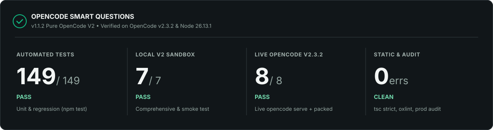
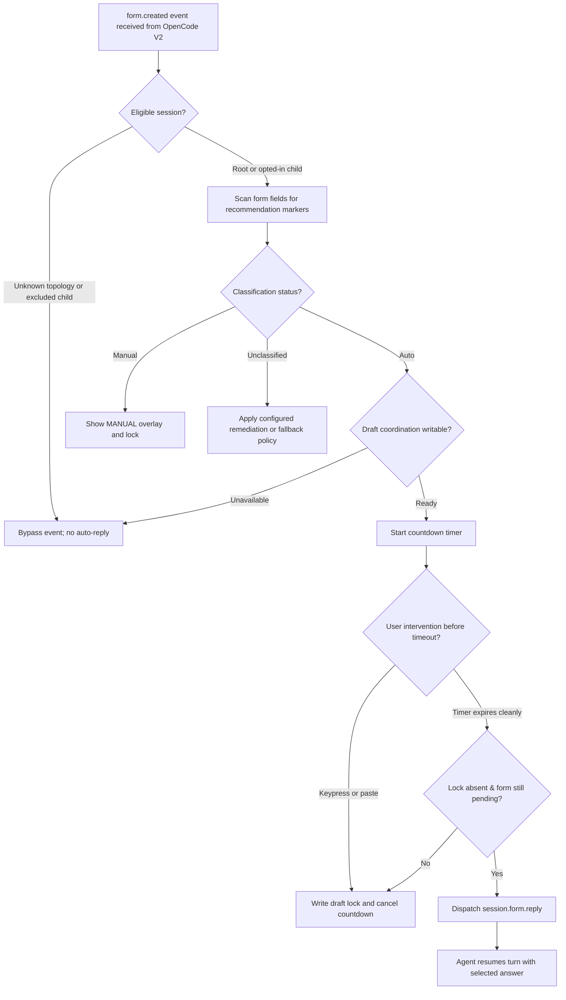

# 💡 OpenCode Smart Questions

[](https://www.npmjs.com/package/opencode-smart-questions)
[](https://www.npmjs.com/package/opencode-smart-questions)
[](https://opencode.ai)
[](docs/verification.md)
[](docs/acceptance-v2.md)
[](package.json)
[](tsconfig.json)
[](LICENSE)

[Installation](#-installation) · [How Selection Works](#-how-selection-works) · [Architecture & Flowchart](#-architecture--selection-lifecycle) · [Guardian Coordination (Optional)](#-optional-coordination-with-opencode-guardian) · [Configuration](#-configuration) · [Validation](#-validation--testing)

A high-performance, deterministic **OpenCode V2** plugin (`@opencode/plugin` `2.3.0+`) that automatically answers agent-recommended form choices after a configurable countdown, unless the user intervenes. It operates completely standalone and supports single-choice and multiple-choice forms on OpenCode V2 (`v2.3.0+`).

**Language-independent selection:** Question text and options can be written in any language. The plugin recognizes exact configured markers such as `[SQ:recommended]`; it does not translate or alter recommendations. Alternative markers like `(Recommended)` and `(Önerilen)` are also recognized by default.

---

## 📊 Verification & Live Acceptance



Smart Questions **v1.2.1** was verified on **22 November 2026**, using Node **26.13.1**, `@opencode/plugin` **2.3.0** (`^2.3.0`), and live OpenCode **v2.3.2**:

- **Unit & Regression Suite:** **166 / 166** tests passing (`npm test`).
- **Live OpenCode v2.3.2 Host Acceptance:** **8 / 8** end-to-end scenarios passing against a live `opencode serve` (`v2.3.2`) instance (`npm run test:acceptance`).
- **Sandbox Scenarios:** **7 / 7** comprehensive V2 scenarios and the separate V2 smoke test pass.
- **Static Analysis & Audit:** Standard and strict TypeScript gates pass; Oxlint reports **0 warnings / 0 errors**; `npm audit` reports **0 vulnerabilities**.

Read the detailed [V2 Acceptance Report](docs/acceptance-v2.md) and [Technical Verification](docs/verification.md) for full reproduction steps and test harnesses.

See the [1.2.1 release notes](CHANGELOG.md) for Plugin Mesh Bridge `2.3.1` (`onSessionForget`, cross-directory RPC standby), nested `prompt`/`info` provenance merging, in-flight remediation budget & lease race fixes, and `context` hook handoff prioritization.

---

## ✨ Key Highlights

- **100% Standalone OpenCode V2 Operation:** Built purely on `@opencode/plugin` (`2.3.0+`) and `@opencode/plugin/tui` using `Plugin.define(...)` without any V1 legacy code or external runtime dependencies.
- **Flexible Recommendation Matching:** Recognizes prefix (`(Recommended)`, `(Önerilen)`), suffix (`[SQ:recommended]`), description text, case-insensitive variations, and Turkish tokens across single-select and multi-select forms.
- **Multi-Field Fallback:** With an explicit fallback policy, recommended fields retain their selections and unresolved fields use the first option. The default policy requests bounded agent remediation via `session.synthetic`.
- **Configurable Fallback & Policies:** Supports `unclassifiedQuestionPolicy: 'fallback-first' | 'remediate-then-fallback' | 'remediate' | 'ignore'`, `fallbackToFirstOption: true`, and `fallbackOnManual: true`.
- **Comprehensive Overlay State Visibility:** Renders dedicated visual states across all handled selectable forms: **AUTO** (cyan border, green checklist, countdown timer), **MANUAL** (yellow border, manual decision required), **UNCLASSIFIED** (cyan border, agent remediation in progress), and **ERROR** (red border).
- **Fingerprint-Scoped Loop Protection:** Unclassified form loop budgets are strictly scoped to identical failure chains and question fingerprints. Chains cleanly reset upon successful AUTO selection, explicit MANUAL classification, form settlement, or new user inbox messages.
- **Transport Failure Resilience:** Failed synthetic prompt remediation preserves retry capability without exhausting duplicate or budget state.
- **Instant User Intervention:** Cancels countdown immediately upon user keypress, paste, draft file locking, or manual form selection.
- **Subagent & Child Scope:** Root sessions are eligible by default. Set `includeSubagents: true` to include host-confirmed child sessions; unknown session topology remains ineligible.
- **Zero Runtime Dependencies:** Pure TypeScript compiled to `dist/` with no third-party runtime dependencies.
- **Decoupled Guardian & Plugin Mesh Coordination:** Optional, zero-dependency handoff (`[OPENCODE_HANDOFF:v1]`) and session-lease (`user_interaction`) coordination when paired with [OpenCode Guardian](https://github.com/huseyincig/opencode-guardian), [OpenCode Hi](https://github.com/huseyincig/opencode-hi), or other OpenCode V2 mesh plugins.

---

## 📦 Installation

The current version is **1.2.1** (OpenCode **v2.3.0+**, verified on **v2.3.2**).

You can install **OpenCode Smart Questions** globally for all workspaces, per-project, via npm/CLI, or from a local checkout.

### 1. 🌍 Global Installation (All Workspaces — Recommended)

Add the plugin to your global OpenCode configuration at `~/.config/opencode/opencode.json` (or `~/.config/opencode/opencode.jsonc`):

```json
{
  "plugins": ["opencode-smart-questions@latest"]
}
```

Or pin an exact version and pass optional inline plugin settings:

```json
{
  "plugins": [
    [
      "opencode-smart-questions@1.2.1",
      {
        "timeoutMs": 30000,
        "includeSubagents": false
      }
    ]
  ]
}
```

You can also install the package globally with npm so it is cached offline across all environments:

```bash
npm install -g opencode-smart-questions
```

### 2. 📁 Project-Scoped Installation (Single Repository)

To enable the plugin only for a specific repository, add it to `<project>/opencode.json` or `<project>/.opencode/opencode.json`:

```json
{
  "plugins": ["opencode-smart-questions@latest"]
}
```

Or install it into your project's `node_modules` via npm:

```bash
npm install -D opencode-smart-questions
```

### 3. 🧩 Package Exports & Entrypoints (Server + TUI)

OpenCode V2 automatically resolves both entrypoints from the single `"opencode-smart-questions"` specifier, or you can reference subpaths explicitly in custom hosts:

| Subpath | Plugin ID | Description |
| :--- | :--- | :--- |
| `opencode-smart-questions` (`.`) | `opencode-smart-questions` | OpenCode V2 server plugin (`context`/`prompt` hooks, SSE event subscriber, mesh RPC & leases) |
| `opencode-smart-questions/server` | `opencode-smart-questions` | Explicit alias for the V2 server plugin (`dist/index.js`) |
| `opencode-smart-questions/tui` | `opencode-smart-questions.tui` | OpenCode V2 TUI plugin (`session.composer.top` slot, countdown timer, keyboard cancellation, `session.form.reply`) |
| `opencode-smart-questions/ui` | `opencode-smart-questions.tui` | Standalone bundled TUI module (`dist/ui.js`) |

### 4. 🛠️ Local Development (`file://` Checkout)

Clone the repository, build `dist/`, and reference the checkout in either your global (`~/.config/opencode/opencode.json`) or project (`opencode.json`) config:

```bash
git clone https://github.com/huseyincig/opencode-smart-questions.git
cd opencode-smart-questions
npm ci && npm run build
```

```json
{
  "plugins": ["file:///absolute/path/to/opencode-smart-questions"]
}
```

---

## ⚡ How Selection Works

1. The agent marks each recommended option by appending `[SQ:recommended]` to its label.
2. The V2 server plugin (`session.hook('context')`) injects concise guidance into eligible sessions, while the V2 TUI plugin intercepts `form.created` and runs `classifyV2Form`.
3. With the default `unclassifiedQuestionPolicy: "remediate"`, unclassified forms request bounded agent remediation via `client.session.synthetic`. Explicit fallback policies can select the first option for unresolved fields while preserving recommendations in the other fields. Ambiguous label-to-value mappings never auto-submit.
4. A countdown timer begins (`30000 ms` default). Any keyboard press, paste, or manual selection cancels the pending countdown immediately and writes a draft lockfile.
5. If the form remains pending and eligible upon expiry, the TUI validates the lockfile and submits `context.data.session.form.reply`.

> [!IMPORTANT]
> **Selection is not permission.** The plugin cannot determine whether a recommendation is safe, reversible, or authorized. Destructive operations should always require explicit human approval.

---

## 🔄 Architecture & Selection Lifecycle



---

## 🤝 Optional: Coordination with OpenCode Guardian

Smart Questions is **100% standalone and has no dependencies on Guardian**.

However, when used together in the same OpenCode environment, they optionally coordinate through a decoupled, zero-dependency handoff protocol (`[OPENCODE_HANDOFF:v1]`):

- **Destructive Action Safety:** With the default `fallbackOnManual: false`, Guardian's `auto_select=forbidden` suppresses the countdown and requires manual input. Enabling `fallbackOnManual` opts out of that manual classification guard; it does not grant execution permission.
- **Safe Clarifications:** For routine choices, Guardian sets `auto_select=allowed`, allowing Smart Questions to execute its standard countdown.
- **Anti-Spoofing & Replay Protection:** Handshakes without valid provenance are rejected; handoffs expire after 120s TTL and consumed IDs are retained in bounded replay-protection memory.

📖 For architecture diagrams, sequence flows, and contract details, see the [Guardian + Smart Questions Coordination Guide](docs/guardian-integration.md).

---

## ⚙️ Configuration (`smart-question.json`)

Settings are resolved hierarchically from `<project>/.opencode/smart-question.json`, `<project>/smart-question.json`, or `~/.config/opencode/smart-question.json`:

```json
{
  "enabled": true,
  "timeoutMs": 30000,
  "includeSubagents": false,
  "unclassifiedQuestionPolicy": "remediate",
  "fallbackOnManual": false,
  "recommendedMarkers": [
    "[SQ:recommended]",
    "(Recommended)",
    "(Önerilen)"
  ],
  "requireExactlyOneRecommendation": true,
  "uiText": {
    "recommendation": "Recommendation:",
    "disabled": "AUTO-SELECTION DISABLED",
    "autoReplyFailed": "Auto-reply failed. Please select manually.",
    "agent": "Agent:",
    "session": "Session:"
  },
  "debugLog": ""
}
```

### 🎛️ Configuration Options:

| Setting | Default | Description |
| :--- | :---: | :--- |
| `enabled` | `true` | Enables or disables the plugin. |
| `timeoutMs` | `30000` | Countdown duration in milliseconds before auto-selecting. |
| `includeSubagents` | `false` | Opts host-confirmed child sessions into guidance, countdown and reply handling. Unknown topology is excluded. |
| `unclassifiedQuestionPolicy` | `"remediate"` | `remediate`, `ignore`, `fallback-first`, or `remediate-then-fallback`. Budget exhaustion with fallback preserves existing recommendations. |
| `maxUnclassifiedRemediations` | `3` | Maximum protocol-remediation attempts in the same question-fingerprint chain. |
| `fallbackToFirstOption` | `false` | Enables immediate first-option fallback for unresolved steps. |
| `fallbackOnManual` | `false` | Allows manual classifications, including Guardian's forbidden handoff, to proceed through normal recommendation/fallback detection. |
| `recommendedMarkers` | `["[SQ:recommended]", ...]` | Accepted suffix markers indicating an agent recommendation. |
| `requireExactlyOneRecommendation` | `true` | Legacy compatibility setting; setting it to `false` alone does not relax single-choice ambiguity checks. Explicit fallback policies have separate behavior. |
| `uiText` | English labels | Localized TUI text strings for labels and warning notices. |
| `debugLog` | `""` | File path for append-only diagnostic logging (`0600` permissions). |

---

## 🧪 Validation & Testing

Run the full verification suite locally:

```bash
npm ci
npm run typecheck
npm run typecheck:strict
npm run lint
npm run test:all
node sandbox/smoke-test.mjs
node sandbox/comprehensive-test.mjs
npm audit
npm pack --dry-run
```

- **CI Matrix:** Runs on Node 22, 24, and 26 with strict typechecking and Oxlint verification.
- **Acceptance Report:** See [V2 Acceptance](docs/acceptance-v2.md) for live OpenCode `v2.3.2` host verification.
- **Technical Specifications:** Detailed boundaries and limitations are documented in [Technical Verification](docs/verification.md).

---

## 🏗️ Project Layout

- `src/index.ts`: Pure OpenCode V2 server plugin (`Plugin.define`) registering `context`/`prompt` hooks, `event.subscribe`, and mesh state RPC.
- `src/ui.tsx`: Pure OpenCode V2 TUI plugin (`Plugin.define`) with reactive Solid overlay, countdown, `user_interaction` leases, and `session.form.reply`.
- `src/bridge.ts`: Universal OpenCode V2 Plugin Mesh bridge (`BRIDGE_REVISION: 2.3.1`) providing capability discovery, session leases, provenance envelopes, and failover RPC.
- `src/backend.ts`: Shared unclassified remediation prompt builder.
- `src/detector.ts`: Pure recommendation parser enforcing single/multi-choice invariants.
- `src/handoff.ts`: `[OPENCODE_HANDOFF:v1]` protocol parser, Guardian/Mesh provenance checks, and TTL/replay tracking.
- `src/form-adapter.ts`: OpenCode V2 form schema adapter and field value mapper.
- `src/draft-guard.ts`: POSIX file-based draft locks preventing auto-reply during user typing.
- `src/config.ts`: Configuration resolver and JSON schema validator.
- `src/session-scope.ts`: V2 session hierarchy analyzer ensuring root-agent isolation.

---

## 📄 License

MIT © [Hüseyin Hadi Çığ](https://github.com/huseyincig)
