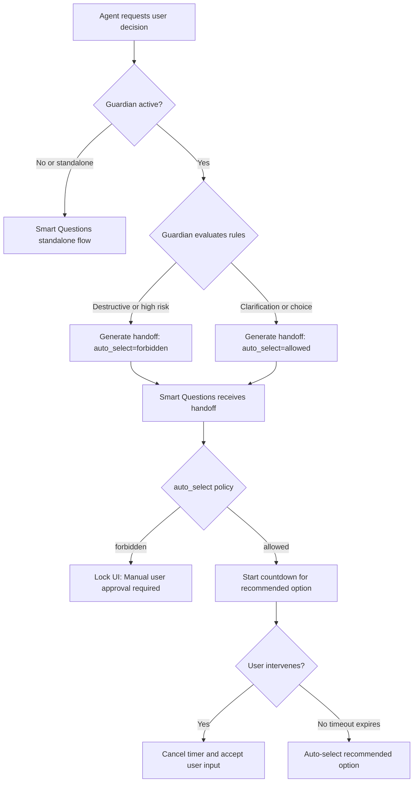
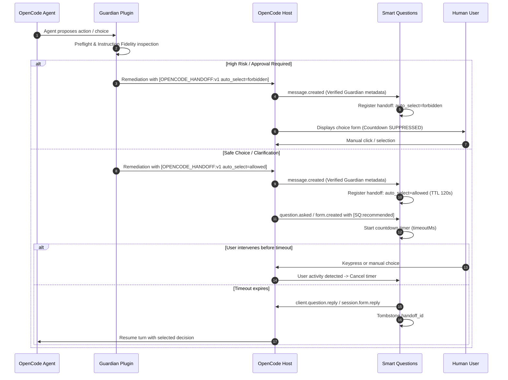

# Guardian + Smart Questions Coordination Protocol

Current documentation: Smart Questions **0.8.2** and Guardian **0.11.2**. See each package's release notes and verification report for current automated results; historical live-host reports retain their original versions.

OpenCode Guardian and Smart Questions are **completely standalone, independent plugins** with zero package dependencies on each other.

When installed together within the same OpenCode workspace or global environment, they optionally coordinate through a decoupled, versioned event handoff protocol (`[OPENCODE_HANDOFF:v1]`).

---

## 🔒 Why Coordinate?

| Standalone Smart Questions | Coordinated with Guardian |
| :--- | :--- |
| Answers recommended questions after a timeout unless the user intervenes. | With the default `fallbackOnManual: false`, Guardian's `auto_select=forbidden` keeps the choice manual. |
| Cannot know if a question asks for destructive file deletions or harmless architectural preferences. | Guardian's deterministic preflight rules intercept risky operations and enforce human-in-the-loop approvals. |

---

## 📡 The Handoff Contract (`[OPENCODE_HANDOFF:v1]`)

When Guardian determines that an agent requires a genuine user decision, it appends a structured handoff block to its internal remediation turn:

```text
[OPENCODE_HANDOFF:v1]
source=guardian
action=question_required
kind=choice
auto_select=allowed
handoff_id=gq_c47f9a12b0
```

### Security & Lifecycle Invariants

1. **Anti-Spoofing:** Handshakes must originate from verifiable Guardian runtime events. Raw text typed by a user or generated by an untrusted agent model is rejected by the provenance extractor.
2. **Default Approval Guard (`auto_select=forbidden`):** Guardian can classify an approval handoff as forbidden for automatic selection. Smart Questions suppresses the countdown while `fallbackOnManual` remains `false`. Enabling that setting opts out of manual classification; it does not authorize tool execution. The diagrams below describe the default policy.
3. **Turn-Bound 120s TTL:** Handoffs remain valid for a maximum of 120 seconds or until the start of a new user turn. Expired handoffs are automatically purged.
4. **Replay Protection:** Consumed handoff IDs are tombstoned in process-wide bounded memory for up to 10 minutes, capped at 512 closed IDs. Retained IDs cannot be resurrected from chat history; this is not persistent or permanent replay protection.
5. **Main Agent Scope Enforcement:** Guardian's interactive handoffs remain root-scoped. Smart Questions independently supports child-session selection with `includeSubagents: true`; it excludes children by default and always excludes unknown session topology.

---

## 🔄 Coordination Flowchart



---

## 📊 Coordination Sequence Diagram


